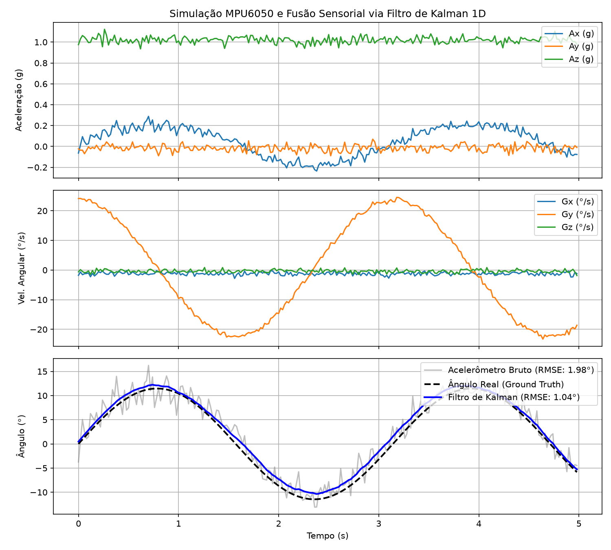

# Fusão Sensorial (MPU6050) e Estimação de Estados via Filtro de Kalman 1D

Este projeto implementa um simulador físico de um sensor inercial de 6 eixos (**MPU6050**) e aplica um **Filtro de Kalman discreto** para estimar o ângulo de inclinação (*pitch*) a partir da fusão entre acelerômetro e giroscópio.



### Arquitetura do Projeto
1. **Simulador Físico (`MPU6050_simulation`):** Gera trajetórias angulares de referência (*Ground Truth*) e simula as leituras do acelerômetro ($g$) e giroscópio ($^\circ/s$) adicionando *offset* residual constante (*bias*) e ruído branco gaussiano independente.
2. **Estimação de Estados (`Filter_Kalman1D`):** Executa as etapas de **predição** (integração da velocidade angular corrigida pelo *bias* estimado) e **atualização** (correção pela projeção da gravidade via `atan2(ax, az)`), reduzindo drasticamente o Erro Médio Quadrático (**RMSE**).

### Tecnologias e Execução
* **Linguagem:** Python 3.x
* **Bibliotecas:** `matplotlib` (e módulos nativos `math`, `random`)

```bash
pip install matplotlib
python kalman_mpu6050.py
```
